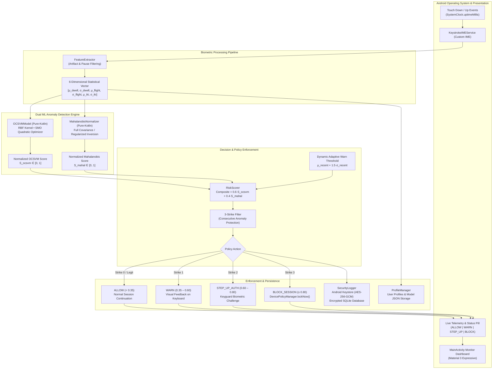
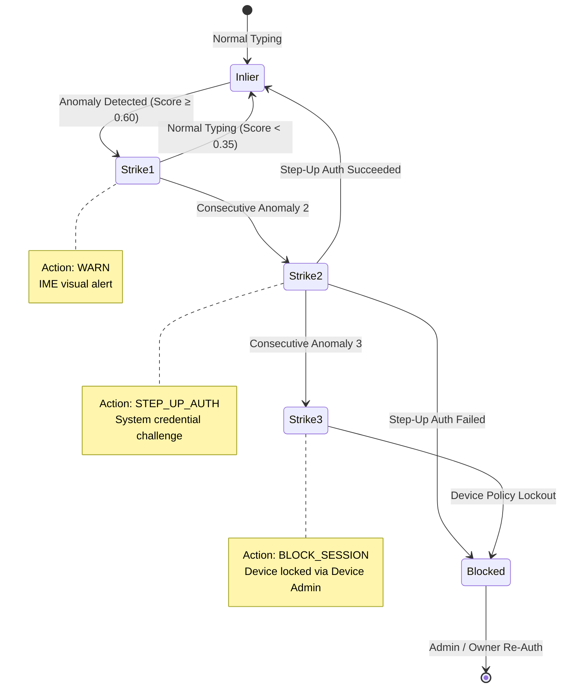

# PuKey: Continuous Behavioral Biometric Authentication System

<!-- [](https://github.com/BUGCS)
[-00E5FF)](#system-naming-disclosure)
[-3DDC84?logo=android&logoColor=white)](https://developer.android.com)
[](https://kotlinlang.org)
[](https://m3.material.io)
[](https://developer.android.com/training/articles/keystore)
[](#machine-learning--biometric-engine)
[](#academic-thesis--citation) -->

> **Official Thesis Title:**  
> *Development of a Continuous Behavioral Biometric Authentication System Using One-Class Support Vector Machine and Mahalanobis Distance for Mobile Device Keystroke Dynamics*  
>  
> **Development Team:** **Team BUGCS**  
> **System Working Title:** **PuKey** ([*Citation / Disclosure: Working title subject to change*](#system-naming-disclosure))

> ### System Naming Disclosure
> **PuKey** is the working operational title for this continuous behavioral biometric authentication system developed by **Team BUGCS**. This project designation is preliminary and is **subject to change** or re-titling upon final academic evaluation, committee defense, and institutional archiving.

---

## Table of Contents

- [System Naming Disclosure](#system-naming-disclosure)
- [Overview & Problem Statement](#overview--problem-statement)
- [Zero-Trust Security Paradigm](#zero-trust-security-paradigm)
- [System Architecture](#system-architecture)
- [Machine Learning & Biometric Engine](#machine-learning--biometric-engine)
  - [1. Feature Extraction Pipeline](#1-feature-extraction-pipeline)
  - [2. One-Class Support Vector Machine (OCSVM)](#2-one-class-support-vector-machine-ocsvm)
  - [3. Mahalanobis Distance Normalizer](#3-mahalanobis-distance-normalizer)
  - [4. Composite Risk Scoring & Adaptive Thresholds](#4-composite-risk-scoring--adaptive-thresholds)
  - [5. Progressive 3-Strike Anomaly Filter](#5-progressive-3-strike-anomaly-filter)
- [Hardware & Platform Integrations](#hardware--platform-integrations)
  - [Custom Input Method Editor (IME)](#custom-input-method-editor-ime)
  - [Device Administration & Hardware Lockout](#device-administration--hardware-lockout)
  - [Step-Up Authentication](#step-up-authentication)
  - [Encrypted Security Logging](#encrypted-security-logging)
- [User Experience & UI Architecture](#user-experience--ui-architecture)
- [Repository Structure](#repository-structure)
- [Prerequisites & Build Requirements](#prerequisites--build-requirements)
- [Installation & Getting Started](#installation--getting-started)
- [User Walkthrough & Operation](#user-walkthrough--operation)
- [Privacy & Threat Mitigation](#privacy--threat-mitigation)
- [Academic Thesis & Citation](#academic-thesis--citation)

---

## Overview & Problem Statement

Conventional mobile security mechanisms rely almost entirely on **point-in-time / episodic authentication** (e.g., biometric fingerprint scanners, facial recognition, or PINs/passwords evaluated once at the device lock screen). Once successfully unlocked, modern smartphones transition into an **implicit trust state** where any holder of the physical device is presumed to be the authorized owner.

This model fails against critical mobile attack vectors:
1. **Device Theft in Active Sessions**: A smartphone snatched while in use (e.g., in public transit or cafés) remains fully unlocked, granting adversaries unfettered access to banking apps, emails, and sensitive credentials.
2. **Co-Worker & Family Impersonation**: An unlocked device left unattended on a desk allows unauthorized third parties to read and manipulate data without re-authenticating.
3. **Shoulder Surfing & Coerced Unlock**: Static PINs and unlock gestures can be observed from afar and subsequently exploited.

**PuKey** (developed by **Team BUGCS**) solves this vulnerability by introducing **continuous, passive, behavioral biometric verification**. Operating transparently at the operating system layer via an Android Custom Input Method Editor (IME), the system continuously models the legitimate owner's micro-timing rhythm—specifically dwell times, flight times, and inter-key intervals—without degrading user experience or recording keystroke content.

```
┌────────────────────────────────────────────────────────────────────────┐
│                        TRADITIONAL MOBILE MODEL                        │
│  [Screen Lock] ──(Fingerprint/PIN)──▶ [Unlocked Session: 100% Trust]   │
│                                           │ (Theft / Takeover)         │
│                                           ▼                            │
│                                   Adversary In Control                 │
└────────────────────────────────────────────────────────────────────────┘

┌────────────────────────────────────────────────────────────────────────┐
│                      PUKEY ZERO-TRUST CONTINUOUS MODEL                 │
│  [Screen Lock] ──▶ [Active Session] ──▶ Continuous Keystroke Timing    │
│                           │                    │                       │
│                           │                    ▼                       │
│                           │            Dual ML Verification            │
│                           │            (OCSVM + Mahalanobis)           │
│                           ▼                    │                       │
│                 Cadence Divergence? ───────────┘                       │
│                     │                                                  │
│                     ├── [Warn]        ──▶ Visual IME Alert             │
│                     ├── [Step-Up]     ──▶ Biometric / PIN Challenge    │
│                     └── [Block]       ──▶ Instant Device Hardware Lock │
└────────────────────────────────────────────────────────────────────────┘
```

---

## Zero-Trust Security Paradigm

The system adheres to modern **Zero-Trust Architecture (ZTA)** principles:
- **Never Trust, Always Verify**: Active possession of an unlocked phone does not imply identity verification. Every interaction window is continuously re-authenticated.
- **Micro-Segmentation of Behavioral Trust**: Trust is treated as an ephemeral metric that degrades when typing patterns diverge from the enrolled user baseline.
- **Fail-Secure Defense-in-Depth**: Escalation occurs smoothly from subtle UI alerts (`WARN`) to explicit biometric confirmation (`STEP_UP_AUTH`) and finally complete OS-level lockout (`BLOCK_SESSION`).

---

## System Architecture

The following diagram illustrates the continuous end-to-end telemetry and scoring pipeline:



---

## Machine Learning & Biometric Engine

All machine learning models and linear algebra operations are developed in **100% pure Kotlin** without requiring heavy native C++ wrappers, external Python bridges, or cloud inferences. This guarantees zero-latency, private, on-device evaluation.

### 1. Feature Extraction Pipeline

The [`FeatureExtractor`](file:///f:/THS1/system/app/src/main/java/com/chate/thesis/FeatureExtractor.kt) class intercepts paired touch events ($t_{\text{down}}$, $t_{\text{up}}$) with microsecond precision and extracts three core temporal metrics:

- **Dwell Time ($T_{\text{dwell}}$)**: The physical duration a key remains held down.

$$
T_{\text{dwell}} = t_{\text{up}}^{(i)} - t_{\text{down}}^{(i)}
$$

- **Flight Time ($T_{\text{flight}}$)**: The latency between releasing the current key and pressing the subsequent key (negative values represent multi-touch rollover typing).

$$
T_{\text{flight}} = t_{\text{down}}^{(i+1)} - t_{\text{up}}^{(i)}
$$

- **Inter-Key Interval ($T_{\text{IKI}}$)**: The total elapsed time between consecutive key presses.

$$
T_{\text{IKI}} = t_{\text{down}}^{(i+1)} - t_{\text{down}}^{(i)}
$$

#### Artifact & Noise Filtering

Mobile typing contains physical noise (touch tremors, deliberate long pauses, browsing delays). Raw events are filtered before statistical aggregation:

- **Dwell Filter**: Discards capacitive touch artifacts under 10 ms and stuck keys over 600 ms ($10\text{ ms} \le T_{\text{dwell}} \le 600\text{ ms}$).
- **Flight Filter**: Discards reading and cognitive pauses exceeding 1.2 s ($-300\text{ ms} \le T_{\text{flight}} \le 1200\text{ ms}$).
- **IKI Filter**: Discards inter-word idle intervals exceeding 1.5 s ($0\text{ ms} \le T_{\text{IKI}} \le 1500\text{ ms}$).

#### 6-Dimensional Statistical Vector

Extracted features across an evaluation window (20 paired keystrokes) are aggregated into a fixed 6-dimensional statistical vector:

$$
\mathbf{x} = \begin{bmatrix} \mu_{\text{dwell}} & \sigma_{\text{dwell}} & \mu_{\text{flight}} & \sigma_{\text{flight}} & \mu_{\text{iki}} & \sigma_{\text{iki}} \end{bmatrix}^T \in \mathbb{R}^6
$$

---

### 2. One-Class Support Vector Machine (OCSVM)

The [`OCSVMModel`](file:///f:/THS1/system/app/src/main/java/com/chate/thesis/OCSVMModel.kt) maps legitimate user timing patterns into a high-dimensional feature space using a **Radial Basis Function (RBF)** Gaussian kernel:

$$
K(\mathbf{x}_i, \mathbf{x}_j) = \exp\left(-\gamma \|\mathbf{x}_i - \mathbf{x}_j\|^2\right), \quad \gamma = \frac{1}{2d} = \frac{1}{12}
$$

#### Dual Optimization via Sequential Minimal Optimization (SMO)

Trained strictly on positive baseline vectors (legitimate user enrollment) by minimizing the dual quadratic objective:

$$
\min_{\boldsymbol{\alpha}} \frac{1}{2} \sum_{i=1}^n \sum_{j=1}^n \alpha_i \alpha_j K(\mathbf{x}_i, \mathbf{x}_j)
$$

subject to the box and equality constraints:

$$
0 \le \alpha_i \le \frac{1}{n \cdot \nu}, \quad \sum_{i=1}^n \alpha_i = 1
$$

- **StandardScaler**: Features are normalized to zero mean and unit variance ($\mu = 0, \; \sigma = 1$).
- **Decision Function**: The hyperplane separation distance is computed across the support vectors:

$$
f(\mathbf{x}) = \sum_{i \in \text{SV}} \alpha_i K(\mathbf{s}_i, \mathbf{x}) - \rho
$$

- **Score Normalization**: Decision values are mapped smoothly into $S_{\text{ocsvm}} \in [0, 1]$, where inliers score $< 0.35$ and anomalous rhythms scale toward $1.0$.

---

### 3. Mahalanobis Distance Normalizer

The [`MahalanobisNormalizer`](file:///f:/THS1/system/app/src/main/java/com/chate/thesis/MahalanobisNormalizer.kt) measures the scale-invariant statistical distance between candidate feature vectors and the user's calibration centroid, accounting for covariance across features:

$$
D_M(\mathbf{x}) = \sqrt{(\mathbf{x} - \boldsymbol{\mu})^T \boldsymbol{\Sigma}^{-1} (\mathbf{x} - \boldsymbol{\mu})}
$$

#### Pure-Kotlin Linear Algebra Engine

- **Cold-Start Handling**: When sample size $N < 50$, the system avoids rank deficiency by utilizing a diagonal variance approximation:

$$
\boldsymbol{\Sigma}^{-1} \approx \operatorname{diag}\left(\frac{1}{\sigma_1^2}, \frac{1}{\sigma_2^2}, \dots, \frac{1}{\sigma_d^2}\right)
$$

- **Full Covariance Inversion**: For $N \ge 50$, the full sample covariance matrix $\boldsymbol{\Sigma}$ is inverted via **Gauss-Jordan elimination with partial pivoting**.
- **Tikhonov Regularization Fallback**: If $\boldsymbol{\Sigma}$ is ill-conditioned or near-singular, a regularization ridge is applied: $\boldsymbol{\Sigma}_{\text{reg}} = \boldsymbol{\Sigma} + 10^{-6} \mathbf{I}$.
- **Normalized Mahalanobis Score**: Scales the raw distance relative to the distribution boundary:

$$
S_{\text{mahal}} = \min\left(\frac{D_M(\mathbf{x})}{10.0}, 1.0\right)
$$

---

### 4. Composite Risk Scoring & Adaptive Thresholds

The [`RiskScorer`](file:///f:/THS1/system/app/src/main/java/com/chate/thesis/RiskScorer.kt) combines the dual model outputs through an optimal weighted fusion:

$$
\text{Composite} = 0.6 \cdot S_{\text{ocsvm}} + 0.4 \cdot S_{\text{mahal}}
$$

#### Adaptive Dynamic Warning Threshold

Typing cadence varies naturally under cognitive load or fatigue. To minimize false rejections, the warning threshold $\tau_{\text{warn}}$ dynamically adapts based on a rolling history of recent composite scores (window size 20):

$$
\tau_{\text{warn}} = \operatorname{clip}\left(\mu_{\text{recent}} + 1.5 \cdot \sigma_{\text{recent}}, \; 0.35, \; 0.55\right)
$$

#### Tiered Policy Decision Framework

| Action | Score Range | System Response |
| :--- | :---: | :--- |
| **`ALLOW`** | `[0.00, τ_warn)` (&lt; 0.35) | Legitimate behavioral match. Session proceeds seamlessly without friction. |
| **`WARN`** | `[τ_warn, 0.60)` | Moderate timing divergence. Displays subtle warning telemetry on the IME strip. |
| **`STEP_UP_AUTH`** | `[0.60, 0.80)` | Significant behavioral divergence. Triggers biometric prompt or PIN challenge. |
| **`BLOCK_SESSION`** | `≥ 0.80` | Critical biometric mismatch. Enforces immediate hardware device lockdown. |

---

### 5. Progressive 3-Strike Anomaly Filter

To prevent abrupt lockouts caused by isolated transient anomalies (e.g., momentary distraction, sneezing, or one-handed typing), the system implements a **consecutive strike counter**:



- **Strike 1**: Downgraded to `WARN` (feedback presented to the user).
- **Strike 2**: Prompts `STEP_UP_AUTH` (device credential challenge via Keyguard).
- **Strike 3**: Triggers `BLOCK_SESSION` (device screen locked immediately).
- Any legitimate score within tolerance resets the strike counter to zero.

---

## Hardware & Platform Integrations

### Custom Input Method Editor (IME)
- Implemented as [`KeystrokeIMEService`](file:///f:/THS1/system/app/src/main/java/com/chate/thesis/KeystrokeIMEService.kt) extending Android's `InputMethodService`.
- Functions globally across all third-party messaging apps, browsers, and text fields.
- Houses a real-time **Biometric Status Bar** directly above the key row that displays the active operational mode, threat level, and normalized anomaly score.

### Device Administration & Hardware Lockout
- Utilizes [`ThesisDeviceAdminReceiver`](file:///f:/THS1/system/app/src/main/java/com/chate/thesis/ThesisDeviceAdminReceiver.kt) with `android.permission.BIND_DEVICE_ADMIN`.
- When `BLOCK_SESSION` is declared or step-up authentication is aborted, the application invokes `DevicePolicyManager.lockNow()`, forcing the phone into an immediate hardware lock state.
- In-app lockouts are routed to [`BlockedActivity`](file:///f:/THS1/system/app/src/main/java/com/chate/thesis/BlockedActivity.kt), which overrides navigation to prevent unauthorized bypass.

### Step-Up Authentication
- Handled by [`StepUpAuthActivity`](file:///f:/THS1/system/app/src/main/java/com/chate/thesis/StepUpAuthActivity.kt).
- Integrates with Android's secure `KeyguardManager.createConfirmDeviceCredentialIntent()`.
- Successfully passing the system challenge resets the risk scorer's rolling history and restores the session to `ALLOW`.

### Encrypted Security Logging
- Powered by [`SecurityLogger`](file:///f:/THS1/system/app/src/main/java/com/chate/thesis/SecurityLogger.kt).
- SQLite storage (`security_log.db`) secured using **AES-256-GCM** with keys managed by the **Android Keystore** (`AndroidKeyStore`).
- Every payload includes a unique 12-byte initialization vector (IV) and a 128-bit authentication tag, preventing tampering or unauthorized extraction of timing telemetry.

---

## User Experience & UI Architecture

Designed according to **Material Design 3 Expressive** specifications with a tailored security aesthetic:

- **Color Palette**: Electric Cyan (`#00677E` light / `#00E5FF` dark) paired with Security Slate and Alert Accents (Green for Allow, Amber for Warn, Pink for Step-Up, Red for Block).
- **Expressive Geometry**: 28dp corner radii on hero monitor cards, 24dp action cards, and fully rounded pill controls.
- **Strict Accessibility**: Touch targets strictly adhere to ≥ 48 × 48 dp with responsive haptic feedback.
- **Dynamic 4-Destination Navigation**:
  1. **Biometric Monitor**: Real-time threat gauge, model breakdown cards (OCSVM vs. Mahalanobis), statistical telemetry strip, and interactive verification sandbox.
  2. **Biometric Enrollment**: 4-step guided wizard (Welcome → Setup → Calibration → Ready) with curated pangram prompts (`The quick brown fox...`, `Pack my box with five dozen liquor jugs...`).
  3. **Settings**: IME selection shortcuts, Device Admin permission toggles, and calibration thresholds.
  4. **Security Logs**: Real-time decrypted audit feed with event timestamps, risk scores, and security actions.

---

## Repository Structure

```
thesis-system/
├── app/
│   ├── src/
│   │   ├── main/
│   │   │   ├── java/com/chate/thesis/
│   │   │   │   ├── ThesisApplication.kt          # Global Application singleton & dynamic theming
│   │   │   │   ├── MainActivity.kt               # Central coordinator (Monitor, Wizard, Logs)
│   │   │   │   ├── KeystrokeIMEService.kt        # Custom Android IME with real-time HUD
│   │   │   │   ├── FeatureExtractor.kt           # Dwell, flight, and IKI extraction engine
│   │   │   │   ├── OCSVMModel.kt                 # Pure-Kotlin OCSVM with RBF kernel & SMO
│   │   │   │   ├── MahalanobisNormalizer.kt      # Gauss-Jordan matrix inversion & distance
│   │   │   │   ├── RiskScorer.kt                 # Weighted fusion, adaptive bounds, 3-strike logic
│   │   │   │   ├── ProfileManager.kt             # User profile SQLite & JSON model persistence
│   │   │   │   ├── SecurityLogger.kt             # Android Keystore AES-256-GCM encrypted audit log
│   │   │   │   ├── StepUpAuthActivity.kt         # Keyguard credential verification dialog
│   │   │   │   ├── BlockedActivity.kt            # Session lockout enforcement activity
│   │   │   │   ├── ThesisDeviceAdminReceiver.kt  # Android DevicePolicyManager receiver
│   │   │   │   └── EventLogAdapter.kt            # RecyclerView adapter for security audit stream
│   │   │   ├── res/
│   │   │   │   ├── layout/                       # Expressive Material 3 layout hierarchies
│   │   │   │   ├── drawable/                     # Tonal surfaces, squircle badges, pill steppers
│   │   │   │   ├── values/                       # Light theme tokens, dimensions, strings
│   │   │   │   ├── values-night/                 # Dark theme tokens
│   │   │   │   └── xml/                          # IME method and Device Admin policies
│   │   │   └── AndroidManifest.xml               # Service declarations, permissions, receivers
│   │   └── test/java/com/chate/thesis/
│   │       └── ExampleUnitTest.kt                # Unit tests for filtering, OCSVM, FAR & FRR
│   └── build.gradle.kts                          # Module-level Gradle configuration (SDK 34)
├── gradle/                                       # Gradle wrapper distribution
├── build.gradle.kts                              # Project-level build script
├── settings.gradle.kts                           # Module inclusion and repository settings
├── PRODUCT.md                                    # Impeccable product and UX specifications
├── DESIGN.md                                     # Material 3 Expressive design tokens
└── README.md                                     # System documentation
```

---

## Prerequisites & Build Requirements

- **Android Studio**: Iguana (2023.2.1) / Jellyfish (2023.3.1) or newer
- **Android SDK**:
  - `compileSdk`: **34** (Android 14)
  - `targetSdk`: **34**
  - `minSdk`: **26** (Android 8.0 Oreo)
- **Java Development Kit**: JDK 17 (Recommended for Gradle 8.x)
- **Physical Device or Emulator**: Android 8.0+ with lock screen security enabled (PIN, pattern, or fingerprint configured for step-up authentication)

---

## Installation & Getting Started

### 1. Clone Repository
```bash
git clone https://github.com/BUGCS/PuKey.git
cd PuKey
```

### 2. Build via Gradle
Build the debug APK using the Gradle wrapper:

```bash
# On Linux / macOS
./gradlew assembleDebug

# On Windows PowerShell
.\gradlew.bat assembleDebug
```

### 3. Run Automated Unit Tests
Verify model calibration, outlier rejection, and timing filter tests:

```bash
# On Linux / macOS
./gradlew test

# On Windows PowerShell
.\gradlew.bat test
```

### 4. Install onto Device
Connect your physical device via USB debugging or start an Android Virtual Device (AVD):

```bash
adb install -r app/build/outputs/apk/debug/app-debug.apk
```

---

## User Walkthrough & Operation

### Step 1: Initial Permission Setup
1. Launch **PuKey** (Thesis Biometrics).
2. Navigate to **Biometric Enrollment** or **Settings**.
3. Tap **Enable Keyboard** → Toggle on **Keystroke Authenticator** under Android System Settings.
4. Tap **Select Keyboard** → Choose **Keystroke Authenticator** as your default input method.
5. Tap **Activate Device Admin** → Grant administration permissions so the system can lock the phone upon detecting an impostor.

### Step 2: Guided Typing Calibration
1. Navigate to the **Biometric Enrollment** tab.
2. Follow the 4-step onboarding wizard:
   - Type the guided pangram prompts (e.g., *"The quick brown fox jumps over the lazy dog."*).
   - Enter at least **250 keystrokes** (testing mode) or **500 keystrokes** (production mode).
3. Once calibration concludes, the application automatically fits the OCSVM model and Mahalanobis covariance matrices, transitioning status to **READY**.

### Step 3: Continuous Monitoring & Sandbox Testing
1. Navigate to the **Biometric Monitor** tab.
2. Toggle **Live Verifier Active**.
3. Type inside the test sandbox or any messaging application:
   - **Legitimate Typing**: The keyboard indicator remains green (`ALLOW`), with composite risk < 0.35.
   - **Simulated Impostor Typing**: Type with exaggerated pauses, alternating speeds, or pass the device to another person.
   - The status transitions to yellow (`WARN`), then triggers a system credential dialog (`STEP_UP_AUTH`), and finally locks the screen (`BLOCK_SESSION`).

### Step 4: Audit Trail Inspection
1. Navigate to the **Logs** tab.
2. View real-time, decrypted security events containing timestamps, threat levels, and policy decisions.

---

## Privacy & Threat Mitigation

| Risk / Attack Vector | Mitigation Strategy in PuKey (Team BUGCS) |
| :--- | :--- |
| **Keystroke Snooping & Keylogging** | The system **never stores or transmits typed characters**. Only anonymized millisecond timing intervals ($t_{\text{dwell}}, t_{\text{flight}}, t_{\text{iki}}$) are evaluated. |
| **Cloud Surveillance & Data Leaks** | Inference and model training execute **100% locally on-device**. The application requests zero network or internet permissions (`android.permission.INTERNET` is omitted). |
| **Tampering with Audit Logs** | Security logs are encrypted with **AES-256-GCM** using keys generated within the hardware-backed **Android Keystore**, making database extraction unreadable without device credentials. |
| **Adversarial Noise & False Alarms** | The **3-Strike Anomaly Filter** and **Adaptive Rolling Thresholds** prevent false rejections caused by momentary distractions or fatigue. |
| **Direct Session Takeover** | Immediate integration with **DevicePolicyManager** terminates the session and locks the phone before data exfiltration can occur. |

---

## Academic Thesis & Citation

This project constitutes the practical engineering implementation of the following research thesis conducted by **Team BUGCS**:

```bibtex
@mastersthesis{bugcs2026pukey,
  author       = {{Team BUGCS}},
  title        = {Development of a Continuous Behavioral Biometric Authentication System 
                  Using One-Class Support Vector Machine and Mahalanobis Distance for 
                  Mobile Device Keystroke Dynamics},
  howpublished = {PuKey Behavioral Biometric Authentication System},
  year         = {2026},
  school       = {College of Computer Studies},
  address      = {Philippines},
  note         = {Android Native Zero-Trust Behavioral Biometrics Implementation. 
                  Citation Note: The system moniker "PuKey" is a working title 
                  and is subject to change upon final academic defense and publication.}
}
```

> **Citation & Title Disclaimer**:  
> The system identifier **"PuKey"** represents an active working project title assigned by **Team BUGCS**. It remains **subject to revision, formal re-titling, or alteration** during the final peer defense, academic review, and publication submission process.

---

<p align="center">
  <sub>Developed by <b>Team BUGCS</b> • Built with Material 3 Expressive & Kotlin</sub>
</p>